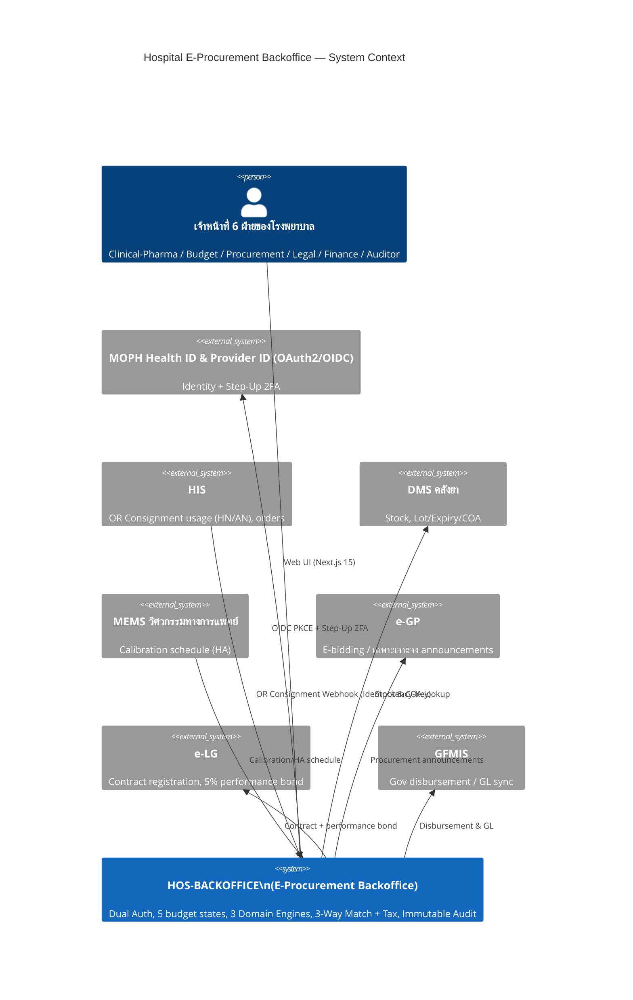
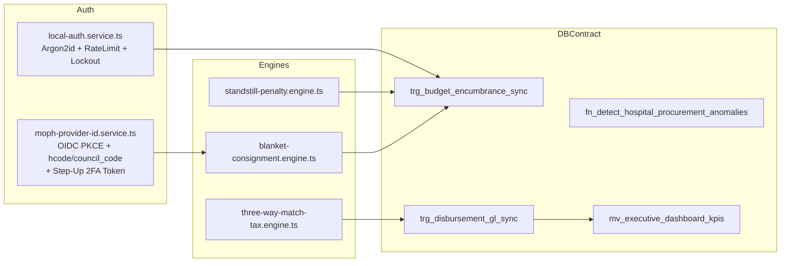
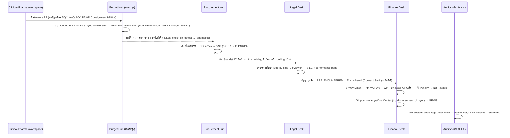
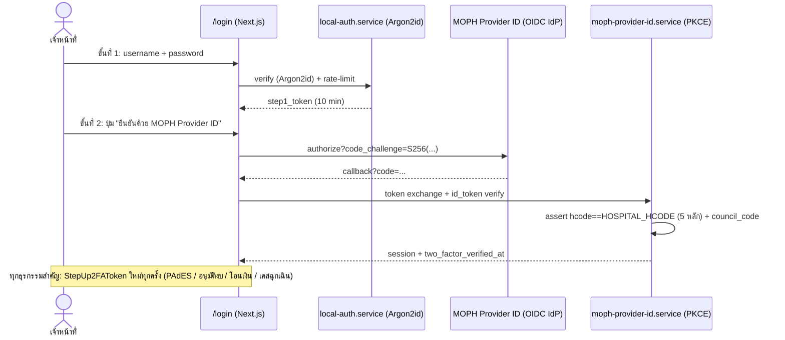

# 🏥 Hospital E-Procurement Backoffice — Architecture Specification
**Project:** `HOS-BACKOFFICE` (`C:\HOS-BACKOFFICE`)
**Owner:** `@Architect` (dgx-deepseek-r1:32b) — Ticket #2
**Version:** 1.0 · **Status:** Canonical (cross-agent contract)
**Context:** Large Thai government hospital (ศูนย์/มหาวิทยาลัย/ตติยภูมิ, 1,000+ beds) — e-procurement backoffice under พ.ร.บ. จัดซื้อจัดจ้างฯ พ.ศ. 2560

---

## 1. C4 Architecture

### 1.1 Level 1 — System Context



### 1.2 Level 2 — Container Diagram

```mermaid
C4Container
    title HOS-BACKOFFICE — Containers
    Person(Officer, "เจ้าหน้าที่โรงพยาบาล")
    Container_Web(BFF_UI, "Next.js 15 App Router", "React 19 + Tailwind", "2-Step Login, /dashboard, /workspace/[role], /auditor, 8 Core Components")
    Container(API, "API Route Handlers", "Next.js Route Handlers + services", "/api/auth/*, /api/dashboard/kpis, /api/procurement/pr, /api/contracts/call-off, /api/disbursement/3way-match")
    Container(ENGINES, "Domain Engines", "TypeScript services", "standstill-penalty / blanket-consignment / three-way-match-tax")
    Container_Queue(Hook, "HIS Webhook Receiver", "Idempotency-Key dedupe", "OR Consignment usage → inspection + PO")
    ContainerDb(DB, "PostgreSQL 15+", "DDL + PL/pgSQL triggers + RLS", "001_hospital_eprocurement_schema.sql")
    ContainerDb(Cache, "Redis 7", "Cache layer", "KPI payload < 50ms, rate-limit, lockout counters")
    Rel(Officer, BFF_UI, "HTTPS")
    Rel(BFF_UI, API, "Server Actions / fetch")
    Rel(API, ENGINES, "in-process")
    Rel(Hook, ENGINES, "webhook")
    Rel(ENGINES, DB, "SQL (FOR UPDATE)")
    Rel(API, Cache, "GET/SET KPI")
    Rel(DB, Cache, "REFRESH MATERIALIZED VIEW CONCURRENTLY (pg_cron)")
```

### 1.3 Level 3 — Component (core module)



---

## 2. Cross-Department Data Flow (6 ฝ่าย)



### 2.1 4 แหล่งเงิน (fund sources) — canonical names
1. `GOV_BUDGET` — งบประมาณแผ่นดิน
2. `HOSPITAL_MAINTENANCE` — เงินบำรุงโรงพยาบาล
3. `DONATION_SPECIFIED` / `DONATION_UNSPECIFIED` — เงินบริจาค (ระบุ / ไม่ระบุวัตถุประสงค์)
4. `UC_DEPRECIATION` — งบค่าเสื่อม สปสช.

### 2.2 5 สถานะวงเงิน (canonical spelling — ใช้คำนี้ทั้งระบบ ห้ามสะกดผิด)
`Allocated` · **`PRE_ENCUMBERED`** (DB value; UI label `Pre-Encumbered`) · `Encumbered` · `Carry-Over Encumbered` · `Disbursed`

---

## 3. Dual Authentication Architecture (2 ชั้น)

| ชั้น | กลไก | รายละเอียด |
|---|---|---|
| 1 — Local | `Argon2id` | m=64MiB, t=3, p=4 (min); Rate limit 5/min/IP+username; Lockout 15 min after 10 fails (Redis counters) |
| 2 — MOPH | OAuth 2.0 / OIDC **PKCE** | Health ID & Provider ID ของ สธ.; ตรวจสอบ `provider_id`, `hcode` 5 หลัก (ต้อง = โรงพยาบาล), `council_code`; ออก session |
| Step-Up | `StepUp2FAToken` | หมดอายุ 5 นาที, ใช้ครั้งเดียว, **บังคับซ้ำ**ก่อน: อนุมัติงบ/PR · ลงนาม PAdES · อนุมัติเคสฉุกเฉิน · สั่งโอนเงินเบิกจ่าย |



---

## 4. External Integrations

| ระบบ | ทิศทาง | โปรโตคอล | หมายเหตุ |
|---|---|---|---|
| MOPH Health ID / Provider ID | inbound 2FA | OAuth2/OIDC PKCE | `hcode` 5 หลัก, `council_code` |
| HIS | inbound webhook | HTTPS JSON + `Idempotency-Key` | OR Consignment usage → `or_consignment_usages` → inspection + PO อัตโนมัติ |
| DMS | outbound query | REST | Lot/Expiry/COA stock check |
| MEMS | inbound schedule | REST | ตารางสอบเทียบ HA → `medical_assets_and_reagent_analyzers` |
| e-GP | outbound | REST (ประกาศ) | วิธีจัดซื้อ: เฉพาะเจาะจง / e-Bidding / คัดเลือก / ซื้อร่วม / GPO |
| e-LG | outbound | REST + e-Sign | ลงทะเบียนสัญญา + performance bond 5% |
| GFMIS | outbound | REST + GL feed | เบิกจ่ายสุทธิ `Net Payable` |

---

## 5. Caching Layer — KPI `< 50 ms`

**Target:** `GET /api/dashboard/kpis` P99 < 50 ms.

**Design:**
1. `mv_executive_dashboard_kpis` (materialized view, `UNIQUE INDEX` on `kpi_date` for `REFRESH CONCURRENTLY`) refreshed every 5 min via `pg_cron`.
2. Redis key `kpi:exec:{date}:{fund_filter_hash}` → serialized JSON payload (TTL 300 s).
3. Route handler: `Redis GET` → hit: respond (expect ~2–10 ms); miss: `SELECT ... FROM mv_executive_dashboard_kpis` → `Redis SET` → respond (expect < 50 ms at hospital scale).
4. Budget guard: handler measures `process.hrtime.bigint()`; if > 50 ms → metric `kpi_slo_violation_total` + stale-while-revalidate from previous cache entry.

### 5.1 KPI Payload — JSON Schema (contract สำหรับ `@FrontendDeveloper`)

```json
{
  "$schema": "https://json-schema.org/draft/2020-12/schema",
  "$id": "hos-backoffice/kpi-exec-payload/v1",
  "type": "object",
  "required": ["kpiDate", "funds", "pipeline", "sla", "generatedAtMs"],
  "properties": {
    "kpiDate": { "type": "string", "format": "date" },
    "funds": {
      "type": "array",
      "items": {
        "type": "object",
        "required": ["fundCode", "fundName", "states"],
        "properties": {
          "fundCode": { "enum": ["GOV_BUDGET", "HOSPITAL_MAINTENANCE", "DONATION_SPECIFIED", "DONATION_UNSPECIFIED", "UC_DEPRECIATION"] },
          "fundName": { "type": "string" },
          "states": {
            "type": "object",
            "required": ["allocated", "preEncumbered", "encumbered", "carryOverEncumbered", "disbursed"],
            "properties": {
              "allocated": { "type": "number" },
              "preEncumbered": { "type": "number" },
              "encumbered": { "type": "number" },
              "carryOverEncumbered": { "type": "number" },
              "disbursed": { "type": "number" }
            }
          }
        }
      }
    },
    "pipeline": {
      "type": "object",
      "required": ["openPR", "inStandstill", "blanketPAActive", "consignmentOpenItems", "warrantyAlerts30d", "maAlerts90d", "calibrationDue"],
      "properties": {
        "openPR": { "type": "integer" },
        "inStandstill": { "type": "integer" },
        "blanketPAActive": { "type": "integer" },
        "consignmentOpenItems": { "type": "integer" },
        "warrantyAlerts30d": { "type": "integer" },
        "maAlerts90d": { "type": "integer" },
        "calibrationDue": { "type": "integer" }
      }
    },
    "sla": {
      "type": "object",
      "required": ["payableAging", "netWorkingCapital"],
      "properties": {
        "payableAging": { "type": "array", "items": { "type": "object", "required": ["bucket", "amount"], "properties": { "bucket": { "enum": ["0-30d", "31-60d", "61-90d", "90d+"] }, "amount": { "type": "number" } } } },
        "netWorkingCapital": { "type": "number" }
      }
    },
    "generatedAtMs": { "type": "integer" }
  }
}
```

> **Cross-agent contract:** state keys map 1:1 to DB columns `allocated_amount`, `pre_encumbered_amount`, `encumbered_amount`, `carry_over_encumbered_amount`, `disbursed_amount` (see `001_hospital_eprocurement_schema.sql`) and to `<MultiFundAbsorptionBar />` segments (see Frontend spec).

---

## 6. 3 Core Domain Engines — Specifications

### 6.1 Holiday-Aware Standstill & Penalty Engine (`standstill-penalty.engine.ts`)
- **Standstill:** 7 **working days** from award announcement; calendar = `gov_holiday_calendar` (วันหยุดราชการ + วันพิเศษ ครม.); weekends excluded; วันหยุดพิเศษแทรกกลางนับข้าม (ไม่หยุดการนับวันทำการ).
- **Penalty net days:** `penalty_days = elapsed_working_days_after_due − committee_inspection_days` (หยุดนับวันปรับระหว่างที่คณะกรรมการตรวจรับ — Statutory Exception).
- **Rate & cap:** default `0.5% / day` of contract value; **hard ceiling 10%** → state `PENALTY_CAPPED`, legal review required (ม.102/103 งด/ลด).
- **PO block:** while `standstill_open = TRUE` → `POST /api/contracts/call-off` returns `423 Locked` (client + server action).

### 6.2 Blanket PA & OR Consignment Engine (`blanket-consignment.engine.ts`)
- **Blanket PA quota:** each call-off deducts from `master_blanket_contracts.remaining_quota` inside `trg_budget_encumbrance_sync` with `SELECT ... FOR UPDATE ORDER BY budget_id ASC`; insufficient quota → `409` + rollback.
- **Contract Savings:** if final contract < reserved PR → refund delta to fund in the same transaction.
- **OR Consignment:** HIS webhook `{idempotencyKey, item, qty, hn, an, orUnit}` → dedupe on `idempotency_key UNIQUE` → upsert `or_consignment_usages` → auto-create `receiving_inspections` + PO draft; HN/AN stored PDPA-masked in auditor views.
- **Idempotency contract:** same key + same body → `200` original result; same key + different body → `422 IdempotencyConflict`.

### 6.3 Warranty, MA & Calibration Alert Engine (spec for `medical_assets_and_reagent_analyzers`)
| Alert | Lead time | Trigger |
|---|---|---|
| Performance/warranty bond return | **30 วัน** before due | `performance_bonds.return_due_date` → finance alert + e-LG release |
| MA contract renewal | **90 วัน** before expiry | `contract_milestones.ma_expiry` → procurement + budget |
| Calibration due (HA standard) | per MEMS schedule | `medical_assets_and_reagent_analyzers.calibration_due_date` → MEMS + engineering |

---

## 7. Production-Hardening Rules (binding)
- Deterministic pessimistic locking: `SELECT ... FOR UPDATE ORDER BY budget_id ASC` + `version INT NOT NULL DEFAULT 1` (OCC) + `Idempotency-Key`.
- PAdES-LTV multi-sign quorum + RFC 3161 e-Timestamp; กรรมการทักท้วง → **DB trigger ระงับเบิกจ่ายทันที**.
- Append-only `system_audit_logs`: partitioned SHA-256 hash chain (`prev_hash`, `row_hash`) + daily Merkle root (contract: Security spec `prev_hash/row_hash` field names are canonical).
- Statutory exceptions: Contract Savings คืนใน transaction เดียว · ยกเลิกโครงการคืนงบ 100% · หยุดนับวันปรับช่วงตรวจรับ · lock ที่ 10% · `EMERGENCY_RETROSPECTIVE_PR` SLA countdown + post-hoc dual approval.

## 8. Shared Fixture (canonical — ใช้ตรงกัน DB / Backend / Frontend / Security)
| รายการ | มูลค่า (บาท) |
|---|---:|
| Incl-VAT (ตั้งเบิก 7%) | **1,070,000.00** |
| Ex-VAT = Incl-VAT × 100 / 107 | **1,000,000.00** |
| VAT 7% | 70,000.00 |
| WHT 1% (ของ Ex-VAT) | **10,000.00** |
| Penalty (ส่งมอบล่าช้า) | **50,000.00** |
| **Net Payable = Incl-VAT − WHT − Penalty** | **1,010,000.00** |

**Formula:** `Net Payable = Incl-VAT − WHT − Penalty`, `Ex-VAT = Incl-VAT * 100 / 107`, `WHT = 1% × Ex-VAT` (ยกเว้น GPO / หน่วยงานรัฐ → 0).
