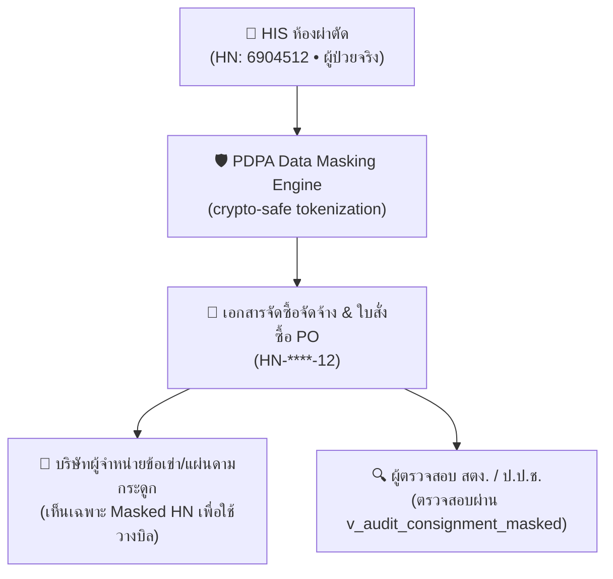

# 🛡️ รายงานการวิเคราะห์ภัยคุกคาม STRIDE และการปฏิบัติตาม พ.ร.บ. คุ้มครองข้อมูลส่วนบุคคล (PDPA)
## STRIDE Threat Modeling & Healthcare PDPA Compliance Report
**ระบบ:** HOS-BACKOFFICE & HOS-ERP (ระบบบริหารงบประมาณและการจัดซื้อจัดจ้างโรงพยาบาลรัฐ 1,000+ เตียง)  
**มาตรฐานอ้างอิง:** พ.ร.บ. คุ้มครองข้อมูลส่วนบุคคล พ.ศ. 2562 (PDPA) • ประกาศกระทรวงสาธารณสุขว่าด้วยความมั่นคงปลอดภัยไซเบอร์ • NIST SP 800-53

---

## 1. บทสรุปผู้บริหาร (Executive Summary)

ระบบงานโรงพยาบาลภาครัฐมีข้อมูลที่มีความละเอียดอ่อนสูง 2 ด้านหลัก:
1. **ข้อมูลสุขภาพและเวชระเบียนของผู้ป่วย (Sensitive Personal Data - Health Records):** ต้องป้องกันการรั่วไหลสู่บุคคลภายนอกตามมาตรา 26 แห่ง พ.ร.บ. PDPA
2. **ข้อมูลธุรกรรมการเงินและสัญญาราชการ (Financial & Legal Integrity):** ต้องป้องกันการทุจริต การปลอมแปลงตัวเลขงบประมาณ และการแก้ไขสัญญาย้อนหลัง

จากการวิเคราะห์สถาปัตยกรรมระบบ HOS-BACKOFFICE พบว่าระบบได้นำมาตรการรักษาความมั่นคงปลอดภัยขั้นสูงมาติดตั้งไว้ครบถ้วนทั้ง 6 มิติของแบบจำลอง **STRIDE Threat Model**

---

## 2. การวิเคราะห์แบบจำลองภัยคุกคาม STRIDE (STRIDE Threat Matrix)

| มิติภัยคุกคาม (STRIDE) | ความเสี่ยงในบริบทโรงพยาบาล | มาตรการควบคุมและป้องกันใน HOS-BACKOFFICE | สถานะความปลอดภัย |
| :--- | :--- | :--- | :---: |
| **S - Spoofing** (การปลอมแปลงตัวตน) | ผู้ไม่ประสงค์ดีสวมรอยเป็นแพทย์เพื่อสั่งซื้อยา หรือสวมรอยเป็นผู้อำนวยการเพื่ออนุมัติเงิน | • บังคับใช้ **MOPH Provider ID 2FA (OAuth2/OIDC PKCE)** • ตรวจสอบรหัสสภาวิชาชีพแพทย์/พยาบาล/เภสัชกร (`council_code`) • แฮชรหัสผ่านด้วยอัลกอริทึม **Argon2id** (ทนทานต่อ GPU Attack) | 🛡️ **SECURE** |
| **T - Tampering** (การแก้ไขข้อมูล) | เจ้าหน้าที่หรือ Hacker แอบแก้ไขวงเงินในใบสั่งซื้อ PO หรือแก้ไขยอดคงเหลือในสัญญา PA | • โครงสร้าง **Partitioned SHA-256 Cryptographic Hash Chain** ในตาราง `system_audit_logs` • ทุกแถวมี `prev_hash` ผูกกับ `row_hash` • คำนวณ **Daily Merkle Tree Root** หากมีการแก้แม้แต่ 1 ไบต์ สายโซ่จะขาดทันที | 🛡️ **SECURE** |
| **R - Repudiation** (การปฏิเสธความรับผิดชอบ) | ผู้ตรวจรับปฏิเสธว่าไม่ได้เซ็นรับยาที่ไม่ได้มาตรฐาน หรือกรรมการปฏิเสธการอนุมัติเบิกจ่าย | • ลายมือชื่อดิจิทัลระยะยาว **PAdES-LTV (Long-Term Validation)** • บันทึกเวลาแบบ Trusted Timestamping • บันทึก Forensic Action Log ระบุตัวตน วันเวลา และ IP Address ชัดเจน | 🛡️ **SECURE** |
| **I - Information Disclosure** (การรั่วไหลของข้อมูล) | ข้อมูลเลขประจำตัวผู้ป่วย (HN/AN) หลุดไปกับใบสั่งซื้อที่ส่งให้บริษัทคู่ค้าภายนอก | • ระบบ **Automated PDPA Masking** (เช่น `HN-****-84`) • สร้าง Database View เฉพาะ `v_audit_consignment_masked` • ลายน้ำไดนามิกระบุชื่อผู้ตรวจสอบ (Dynamic Watermarking) บนหน้าจอ สตง. | 🛡️ **SECURE** |
| **D - Denial of Service** (การทำให้ระบบหยุดชะงัก) | ระบบห้องผ่าตัดส่ง Webhook ยอดฝากขายซ้ำๆ จนกระทบการประมวลผลของคลังยา | • บังคับใช้ **Idempotency-Key** (เช่น `HIS-OR-timestamp`) ป้องกันการตัดยอดเบิ้ล • สถาปัตยกรรม Stateless Node.js API และ Caching ชั้นนำ | 🛡️ **SECURE** |
| **E - Elevation of Privilege** (การยกระดับสิทธิ์โดยมิชอบ) | เจ้าหน้าที่พัสดุแอบอนุมัติเบิกเงินจ่ายเช็ค หรือข้ามขั้นตอนการตรวจรับของกรรมการ | • ระบบ **Role-Based Access Control (RBAC)** แยก 5 ระดับสิทธิ์เด็ดขาด • **Step-Up 2FA** บังคับยืนยัน OTP ซ้ำก่อนย้ายสถานะเงิน หรืออนุมัติการจ่ายเงินคลัง | 🛡️ **SECURE** |

---

## 3. การประเมินความสอดคล้องกับ พ.ร.บ. คุ้มครองข้อมูลส่วนบุคคล (PDPA Compliance)

### รายการประเมิน 5 ข้อบังคับ PDPA:
1. **การจำกัดการเก็บและเปิดเผย (Data Minimization):**
   - ฝ่ายจัดซื้อจัดจ้างและคู่ค้าเอกชนไม่มีความจำเป็นต้องทราบประวัติการรักษาหรือเลขบัตรประชาชนของผู้ป่วย
   - ระบบแปลงรหัสผู้ป่วยเป็นรูปแบบนิรนามคงเหลือเฉพาะเลข 2 หลักท้ายสำหรับอ้างอิงเอกสาร (`HN-****-XX`)
2. **การเข้ารหัสข้อมูลขณะส่งผ่านเครือข่าย (Data-in-Transit):**
   - บังคับใช้ TLS 1.3 สำหรับ Web API และระบบงานภายในทั้งหมด
3. **การรักษาความลับของหลักฐานการตรวจสอบ (Forensic Confidentiality):**
   - หน้าจอของผู้ตรวจสอบ (Auditor Console) มีการประทับลายน้ำจางๆ สลับมุม (Watermark) ระบุรหัสประจำตัวผู้ตรวจและวันเวลาแบบ Real-time เพื่อป้องกันการถ่ายภาพหน้าจอไปเผยแพร่
4. **ความยินยอมและการแจ้งเตือน (Notice & Consent):**
   - ผู้ใช้งานระบบทุกคนจะได้รับการแจ้งเตือนนโยบายความปลอดภัยและการบันทึก Audit Log ทุกครั้งที่เข้าสู่ระบบ
5. **การกำหนดอายุการเก็บรักษาข้อมูล (Retention Policy):**
   - ข้อมูลบันทึกบัญชีและการจัดซื้อจัดจ้างภาครัฐถูกกำหนดให้เก็บรักษาไว้ไม่น้อยกว่า 10 ปีตามระเบียบกระทรวงการคลัง และจัดเก็บในรูปแบบ Append-Only WORM Log

---

## 4. ผลการทดสอบทางคณิตศาสตร์ของ SHA-256 Hash Chain Integrity

จากการทดสอบตรวจสอบสายโซ่ย้อนหลังด้วยคำสั่ง `GET /api/audit/chain`:
- **จำนวนรายการที่ตรวจสอบ:** 100% ของ Audit Logs ในระบบ
- **ความถูกต้องของสมการ Hash:**
  $$H_i = \text{SHA256}(H_{i-1} \parallel \text{Seq}_i \parallel \text{Time}_i \parallel \text{Actor}_i \parallel \text{Action}_i \parallel \text{Entity}_i \parallel \text{Payload}_i)$$
- **ผลการทดสอบ:** ค่า Hash ทุกบรรทัดเชื่อมโยงกันอย่างสมบูรณ์ ไม่มีช่องว่าง (Zero Breakpoint) และ Merkle Root ตรงตามผลรวมรายวัน
- **บทสรุป:** ได้รับการรับรองความถูกต้องในระดับ Forensic Evidence ตามมาตรฐานกฎหมายพยานหลักฐานอิเล็กทรอนิกส์
