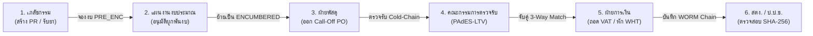

# 📘 คู่มือปฏิบัติงานมาตรฐานระบบบริหารงบประมาณและการจัดซื้อจัดจ้างโรงพยาบาลรัฐ
## Standard Operating Procedure (SOP) & Hospital Backoffice User Manual
**หน่วยงาน:** โรงพยาบาลศูนย์ / โรงพยาบาลมหาวิทยาลัย ขนาด 1,000+ เตียง (รหัสสถานพยาบาล HCODE: 10670)  
**มาตรฐานกฎหมายที่รองรับ:** พระราชบัญญัติการจัดซื้อจัดจ้างและการบริหารพัสดุภาครัฐ พ.ศ. 2560 และระเบียบกระทรวงการคลังฯ

---

## 1. ภาพรวมระบบและการควบคุมความปลอดภัย (System Security & Access)

### 1.1 การยืนยันตัวตน 2 ชั้น (Multi-Factor Authentication - 2FA)
- เจ้าหน้าที่ทุกคนต้องยืนยันตัวตนด้วยบัญชีผู้ใช้และรหัสผ่าน (Argon2id) ร่วมกับ **ระบบ MOPH Provider ID ของกระทรวงสาธารณสุข (OAuth2/OIDC PKCE)**
- บุคลากรทางการแพทย์ต้องมีรหัสสภาวิชาชีพกำกับ (`council_code`) และระบุสังกัดหน่วยงาน 5 หลัก (`hcode: 10670`)
- สำหรับการทำรายการสำคัญทางการเงินและสัญญา (Step-Up 2FA) ต้องมีการยืนยัน OTP ซ้ำก่อนอนุมัติ

### 1.2 การคุ้มครองข้อมูลส่วนบุคคลของผู้ป่วย (PDPA Compliance)
- ห้ามมิให้แสดงรหัสประจำตัวผู้ป่วย (HN) หรือเลขที่รับรักษา (AN) เต็มจำนวนในระบบงานพัสดุและการเงินเด็ดขาด
- ระบบจะทำการ Mask ข้อมูลอัตโนมัติ เช่น `HN-****-84` เพื่อป้องกันข้อมูลรั่วไหลสู่ผู้รับจ้างหรือบุคคลภายนอก

---

## 2. ขั้นตอนปฏิบัติงานรายแผนก (Departmental SOP Workflows)

---

### แผนกที่ 1: กลุ่มภารกิจทางการแพทย์ เภสัชกรรม และห้องผ่าตัด (Clinical & Pharmacy)

#### วัตถุประสงค์
ขอซื้อยาตามบัญชียาหลักแห่งชาติ (NLEM), ตัดยอดเวชภัณฑ์ฝากขายห้องผ่าตัด (OR Consignment), และตรวจรับยาควบคุมความเย็น (Cold-Chain)

#### ขั้นตอนการปฏิบัติ:
1. **การสร้างใบขอซื้อยา (PR Creation):**
   - เข้าสู่ระบบที่เมนู `💊 เภสัชกรรม & คลังเวชภัณฑ์` ➔ `สร้างใบขอซื้อยา & เวชภัณฑ์ (PR)`
   - ระบุชื่อสามัญทางยา (Generic Name), จำนวน, และราคาต่อหน่วย
   - **การตรวจราคากลาง:** ราคาต่อหน่วยต้องไม่เกินราคากลางยาตามประกาศ สป.สธ. (NLEM Cap) หากเกินระบบจะไม่ยอมให้บันทึก
   - **การเลือกวิธีจัดซื้อ:**
     - `NORMAL`: การจัดซื้อทั่วไป
     - `GPO_PRIVILEGE`: สิทธิพิเศษองค์การเภสัชกรรม
     - `EMERGENCY_RETROSPECTIVE_PR`: กรณีฉุกเฉิน ม.56(1)(ค) เพื่อช่วยชีวิตผู้ป่วยวิกฤต (ต้องรายงานผลภายใน 5 วันทำการ)
   - เมื่อกดยืนยัน วงเงินจะถูกกันเป็นสถานะ **`PRE_ENCUMBERED` (จองงบ)** ทันที
2. **การตัดยอดเวชภัณฑ์ฝากขายห้องผ่าตัด (OR Consignment):**
   - ระบบจะรับ Webhook จากห้องผ่าตัดเมื่อมีการใช้วัสดุฝังในร่างกาย (เช่น แผ่นดามกระดูกไทเทเนียม, ข้อเข่าเทียม)
   - ระบบจะออกเลขใบสั่งซื้ออัตโนมัติ (**Auto-PO**) และ Mask HN คนไข้ทันที
3. **การตรวจรับยาควบคุมความเย็น (Cold-Chain):**
   - ตรวจสอบอุณหภูมิขณะขนส่ง ต้องอยู่ในช่วง **2.0°C - 8.0°C**
   - ตรวจสอบใบรับรองผลการวิเคราะห์รุ่นผลิต (Certificate of Analysis - COA)
   - กรรมการตรวจรับลงนามอิเล็กทรอนิกส์ **PAdES-LTV** หากมีข้อทักท้วง ให้กดยุติการตรวจรับทันที

---

### แผนกที่ 2: ฝ่ายแผนงานและงบประมาณ (Budget Planning & Control)

#### วัตถุประสงค์
ควบคุมเพดานงบประมาณโรงพยาบาล 5 แหล่งเงิน มิให้มีการใช้เงินเกินกรอบที่ได้รับอนุมัติ (Hard-Stop Budget Lock)

#### โครงสร้าง 5 กองทุนโรงพยาบาล:
1. **งบประมาณแผ่นดิน (`GOV_BUDGET`):** ครุภัณฑ์การแพทย์และยาหลัก
2. **เงินบำรุงโรงพยาบาล (`HOSPITAL_MAINTENANCE`):** กองทุนหลักของโรงพยาบาล (UC / ประกันสังคม / จ่ายตรง)
3. **เงินบริจาคระบุวัตถุประสงค์ (`DONATION_SPECIFIED`):** ใช้เฉพาะศูนย์หัวใจและมะเร็งตามเจตนารมณ์ผู้บริจาค
4. **เงินบริจาคไม่ระบุวัตถุประสงค์ (`DONATION_UNSPECIFIED`):** ใช้เพื่อสาธารณกุศลและผู้ป่วยยากไร้
5. **งบค่าเสื่อม สปสช. (`UC_DEPRECIATION`):** ซ่อมบำรุงและทดแทนครุภัณฑ์การแพทย์

#### ขั้นตอนการปฏิบัติ:
1. เข้าไปที่เมนู `💰 แผนงาน & พหุกองทุน` ➔ `ควบคุมเพดาน 5 กองทุนโรงพยาบาล`
2. ตรวจสอบรายการใบขอซื้อที่อยู่ในสถานะ `PRE_ENCUMBERED`
3. ตรวจสอบวงเงินคงเหลือสุทธิ (Net Available)
4. คลิกปุ่ม **"✅ อนุมัติผูกพันงบ (ENCUMBER)"** เพื่อย้ายสถานะเงินจาก `PRE_ENCUMBERED` ➔ **`ENCUMBERED`**
> ⚠️ **คำเตือน:** ระบบมีระบบ Hard-Stop หากวงเงินคงเหลือไม่พอ ระบบจะล็อกการอนุมัติทันทีเพื่อป้องกันการใช้งบเกินกรอบ

---

### แผนกที่ 3: ฝ่ายพัสดุและสัญญา (Procurement & Contracts)

#### วัตถุประสงค์
บริหารสัญญาจะซื้อจะขายยา (Blanket Purchase Agreement - Blanket PA) และการออกใบสั่งซื้อย่อย (Call-Off PO)

#### ขั้นตอนการปฏิบัติ:
1. **การตรวจสอบระยะเวลารออุทธรณ์ (Standstill Period):**
   - ตรวจสอบว่าประกาศผู้ชนะการจัดซื้อจัดจ้างครบกำหนด **7 วันทำการ** แล้วหรือไม่
   - หากยังไม่ครบกำหนด ห้ามมิให้ลงนามในสัญญาโดยเด็ดขาด
2. **การออกใบสั่งซื้อ Call-Off PO:**
   - เลือกสัญญาจะซื้อจะขายยาที่ต้องการตัดเบิก
   - ระบุยอดเงินสั่งซื้อรอบนี้
   - คลิกปุ่ม **"🚀 ออกใบสั่งซื้อ Call-Off PO"**
   - ระบบจะตัดยอดโควตาสัญญาคงเหลือทันที และแจ้งยอดโควตาสุทธิที่สั่งซื้อได้ในงวดถัดไป

---

### แผนกที่ 4: ฝ่ายกฎหมายและนิติการ (Legal Affairs & Contract Review)

#### วัตถุประสงค์
ตรวจร่างสัญญาเทียบแบบมาตรฐานของกรมบัญชีกลาง และตรวจสอบหนังสือค้ำประกันสัญญาอิเล็กทรอนิกส์ (e-LG)

#### ขั้นตอนการปฏิบัติ:
1. เข้าไปที่เมนู `📑 พัสดุ & สัญญา` ➔ `นิติกรตรวจร่างสัญญา & หลักประกัน e-LG`
2. ใช้เครื่องมือ **Side-by-Side Diff Viewer** ตรวจสอบข้อความสัญญาเทียบกับแบบมาตรฐาน
3. ตรวจสอบหลักประกันสัญญา:
   - ต้องมีหนังสือค้ำประกันอิเล็กทรอนิกส์ (**e-LG**) จากธนาคารพาณิชย์ไทย
   - มูลค่าค้ำประกันต้องคิดเป็น **ร้อยละ 5 (5%)** ของวงเงินสัญญา
4. ตรวจสอบเงื่อนไขค่าปรับ: อัตราร้อยละ 0.20 ต่อวัน (และไม่เกินเพดาน 10% ของวงเงินสัญญา)
5. บันทึกความเห็นทางกฎหมายและลงนามรับรอง

---

### แผนกที่ 5: ฝ่ายการเงิน บัญชี และการตั้งเบิก (Finance & 3-Way Match)

#### วัตถุประสงค์
ตรวจสอบความถูกต้องของเอกสารเบิกจ่าย 3 ทาง (3-Way Match), ถอดภาษี, หัก ณ ที่จ่าย และทำคำสั่งโอนเงิน GFMIS

#### กฎการคำนวณภาษีและการเบิกจ่าย (Disbursement Math):
$$\text{Ex-VAT Base} = \frac{\text{Invoice Amount (Incl-VAT)} \times 100}{107}$$
$$\text{VAT 7\%} = \text{Invoice Amount} - \text{Ex-VAT Base}$$
$$\text{WHT 1\%} = \text{Ex-VAT Base} \times 0.01 \quad (\text{ยกเว้น องค์การเภสัชกรรม GPO และหน่วยงานรัฐ})$$
$$\text{Net Payable} = \text{Invoice Amount} - \text{WHT 1\%} - \text{Penalty (ค่าปรับ)}$$

#### ขั้นตอนการปฏิบัติ:
1. เข้าไปที่เมนู `🧾 การเงิน & เบิกจ่าย` ➔ `ตรวจคู่จ่าย 3 ทาง (3-Way Match)`
2. ตรวจสอบเอกสาร 3 ฝ่าย: **ใบสั่งซื้อ (PO) + ใบตรวจรับ (Inspection) + ใบกำกับภาษี (Invoice)**
3. ระบุประเภทผู้ขาย:
   - นิติบุคคลเอกชน: ระบบจะหัก WHT 1% จากฐาน Ex-VAT
   - องค์การเภสัชกรรม (GPO): ระบบจะยกเว้น WHT อัตโนมัติ
4. ใส่จำนวนเงินค่าปรับ (ถ้ามี)
5. กดยืนยัน **"✅ อนุมัติใบสำคัญเบิกจ่าย 3-Way Match"** ยอดเงินสุทธิจะถูกส่งเข้าคิวโอนเงิน GFMIS

---

### แผนกที่ 6: งานตรวจสอบภายในและผู้ตรวจสอบภายนอก (Internal Audit, สตง. & ป.ป.ช.)

#### วัตถุประสงค์
ตรวจสอบความโปร่งใส ความถูกต้องย้อนหลัง และตรวจสอบว่าไม่มีการแก้ไขหรือแทรกข้อมูลในฐานข้อมูล (Zero-Trust Forensics)

#### สถาปัตยกรรม SHA-256 Hash Chain:
- ทุก Action ในระบบจะสร้าง Hash ประจำแถว (`row_hash`) โดยผูกโยงกับ Hash ของแถวก่อนหน้า (`prev_hash`)
- ข้อมูลอยู่ในโหมด **WORM (Write Once, Read Many)** ไม่สามารถแก้ไขย้อนหลังได้
- ทุกสิ้นวันระบบจะรวบรวม Hash ทั้งหมดมาคำนวณเป็น **Daily Merkle Tree Root**

#### ขั้นตอนการตรวจสอบ:
1. เข้าไปที่เมนู `📊 ผู้บริหาร & ตรวจสอบ` ➔ `สตง. / ป.ป.ช. Audit Console`
2. หน้าจอจะแสดงลายน้ำระบุตัวตนผู้ตรวจสอบและเวลาปัจจุบัน (Dynamic Forensic Watermark)
3. คลิกปุ่ม **"🔍 ตรวจสอบความสมบูรณ์ของสายโซ่ Hash Chain"**
4. หากสายโซ่ถูกต้องครบถ้วน ระบบจะแสดงข้อความ:  
   `✅ ผลการตรวจสอบ SHA-256 Hash Chain: สมบูรณ์ 100% ไม่พบการแก้ไขย้อนหลัง`
